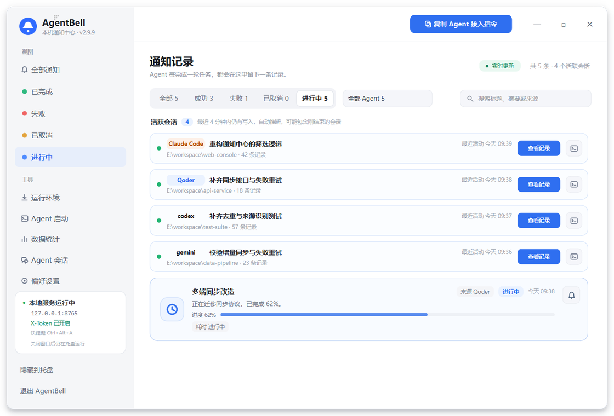
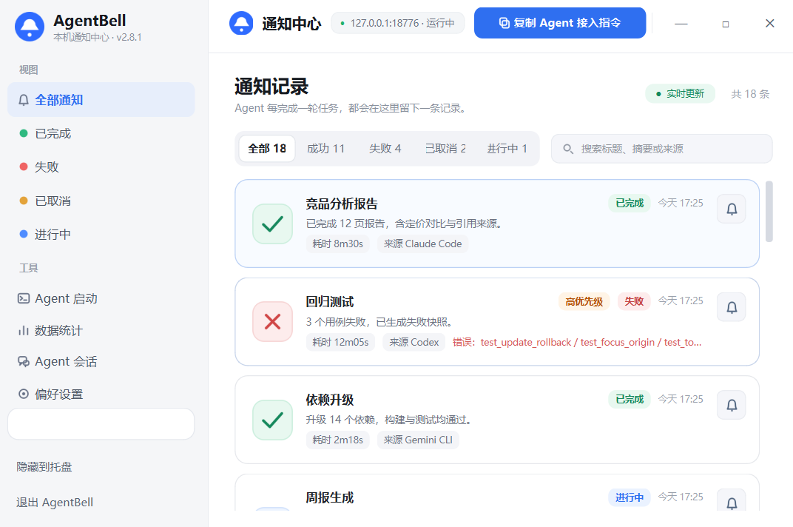
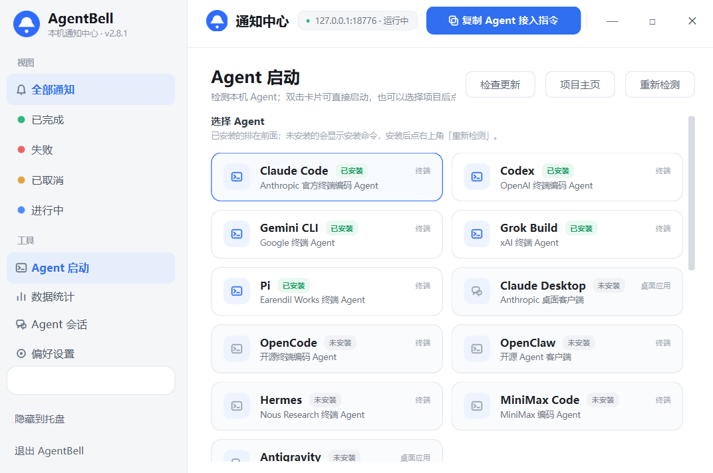
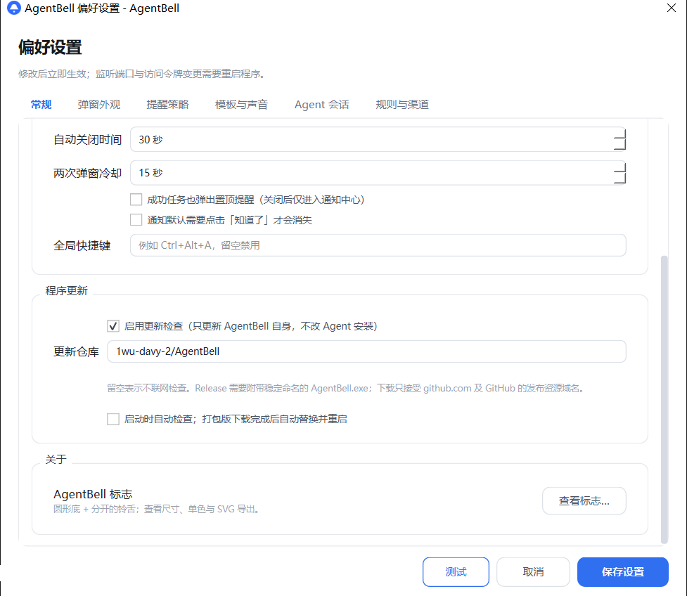
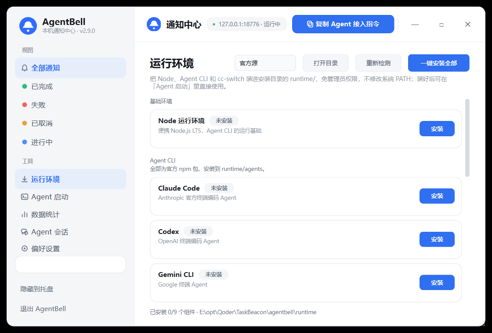

# AgentBell

<p align="center">
  <sub>One ring per agent round, right on your desktop.</sub><br>
  <a href="README.md">简体中文</a> · <strong>English</strong> ·
  <a href="https://1wu-davy-2.github.io/agentbell-site/">Website</a>
</p>

<p align="center">
  <a href="https://github.com/1wu-davy-2/AgentBell/releases/latest"></a>
  <a href="https://github.com/1wu-davy-2/AgentBell/actions/workflows/build.yml"></a>
  <a href="LICENSE"></a>
  
</p>

---

AgentBell is a local-first Windows / macOS / Linux notification desk for AI agents. When an agent finishes a round, it sends one message to a loopback-only HTTP endpoint; AgentBell immediately shows a top-most card in the corner of your desktop, keeps a searchable history, and stays in the system tray after you close the window.

It does not orchestrate agents, proxy model requests, upload data, or ship a web console. The HTTP server binds to `127.0.0.1` only, and every screen is a native PySide6 window. The UI is currently Chinese-first; the HTTP API and configuration are language-neutral.

## Why AgentBell

The starting point was concrete: when Claude Code, Codex, or another agent runs a long task, you keep switching back to check whether it has finished. System notifications are too easy to miss, while a full task dashboard demands constant attention.

AgentBell does one thing well: **tell you the moment a round ends, and let you get back to the scene immediately.**

- **Notice the wait**: when an agent stalls on a permission prompt, question, rate limit, or context limit, cards show the reason; a **Waiting** sub-filter sits under Running.
- **Install reminders in one click**: the Runtime page writes waiting and finish hooks for Claude Code, Gemini CLI, and Grok into their user configs; Codex gets finish-only reminders. Every write is previewed, backed up, and reversible.
- **Replay the run**: events sharing one `run_id` (start, wait, resume, finish) form an append-only timeline; cards open a timeline dialog, and statistics break down run success, P50/P90 duration, and total waiting time.
- **Walk away**: do something else while the agent works. One ring and one card when it finishes.
- **Close the loop**: a notification can focus the terminal (`origin.pid`), open the local session record or run timeline, retry a failed task, or remind you later. Read-only actions never approve permissions or continue an agent.
- **Stay quiet**: quiet hours, fullscreen/meeting suppression, lock-screen holding, digest, and success-only-in-center are all configurable.
- **Route by rules**: match on wait reason, `needs_input`, run duration, and project glob, then override priority, silence, acknowledgement, auto-close, popup, and extra channels. Later matching rules win on scalar fields, and changes apply as soon as settings are saved; **Test run** shows which rule matches a sample notification and the resulting fields.
- **Find anything**: search supports `status:` / `source:` / `priority:` / `session:` / `run:` / `ack:` field filters; statistics offer 7/30/90-day ranges with CSV export, and notifications can be batch-archived and grouped by date or source.
- **Read session records**: read-only scanning covers Claude Code, Qoder, Codex, Gemini, Grok session files and OpenCode's database, with a full reader, in-session search, copy, and Markdown export.
- **Stay quiet**: quiet hours, fullscreen/meeting suppression, lock-screen holding, digest, success-only-in-center, and tray **Do Not Disturb** for 30 minutes, 1 hour, or until tomorrow are all configurable.
- **Local first**: loopback-only HTTP, on-device SQLite history, read-only session parsing, no cloud.
- **Stay small**: no agent orchestration, no workflow changes, no web UI. It waits in the tray and rings when it should.

## Recent updates

- **v2.19.0**: Four new session sources (Codex, Gemini, Grok, and OpenCode's read-only database); waiting inference now also covers Codex, Gemini, and Grok. Search gains `status:` / `source:` field filters, statistics gain 7/30/90-day ranges and CSV export, and notifications can be batch-archived and grouped by date or source. The tray adds quick Do Not Disturb, and rules gain a test run. Platform parity brings macOS global hotkeys, back-to-terminal, presence inference, portable Node, and in-place zip updates; Wayland registers hotkeys through the XDG GlobalShortcuts portal. CI now supports Windows Authenticode and macOS Developer ID signing plus Apple notarization.
- **v2.18.2**: Fixes the release checksums. The Windows x64 and arm64 packaging jobs both wrote `SHA256SUMS.txt`, so the merged file dropped the arm64 executables; each architecture now writes `SHA256SUMS-windows-<arch>.txt` and all 16 assets are covered. Behavior matches 2.18.1.
- **v2.18.1**: Fixes arm64 CI tests. The updater and asset-selection tests assumed the x64 host architecture and failed on Windows, Linux, and macOS arm64 runners; they now pass `machine` explicitly and no longer depend on the build host. The time-formatting test also checks the local-time conversion across DST. Behavior matches 2.18.0, which was never published because its arm64 tests failed.
- **v2.18.0**: Windows arm64 and macOS builds. Windows now ships `AgentBell.exe` (x64) plus `AgentBell-arm64.exe` for Arm64 devices; the updater picks the asset that matches the running architecture and never swaps x64 and arm64 binaries. macOS 14+ gets native `.dmg` and `.zip` builds for Apple Silicon and Intel, signed ad-hoc for local use. The packaged macOS app keeps config, logs, and the database in `~/Library/Application Support/AgentBell` and registers a LaunchAgent. macOS supports cards, the notification center, history, audio, and hooks, but not global hotkeys, focus-terminal, fullscreen/meeting/idle detection, the portable runtime, or in-place updates; install a new `.dmg`/`.zip` manually. Linux gained audio playback and a native port-conflict hint.
- **v2.17.1**: Four Linux package formats. Each architecture now ships `tar.gz`, `AppImage`, `deb`, and `rpm`: the tarball stays portable and self-updating, the AppImage runs as a single file, and deb/rpm installs are managed by the system package manager. All formats come from the same CI pipeline with SHA-256 checksums. AppImage and system-package installs no longer attempt in-place updates; download a new package or upgrade with the package manager. Windows behavior is unchanged. The v2.17.0 tag was never published because its CI run failed; 2.17.1 fixes AppImage tool path resolution and a timing boundary in the wait-scanner test without changing behavior.
- **v2.16.1**: Linux x64 and arm64 builds. Releases now include `AgentBell-linux-x64.tar.gz` and `AgentBell-linux-arm64.tar.gz`; extract and run the `AgentBell` binary. On X11 it supports global hotkeys, back-to-terminal, idle/lock detection, terminal launch, and hook installation; on Wayland these degrade to basic notifications. Windows behavior is unchanged. The v2.16.0 tag was never published because its Linux CI tests failed; 2.16.1 fixes cross-platform path parsing and test assumptions without changing behavior.
- **v2.15.0**: Fullscreen alerts can keep the card on the primary display only. Every monitor still gets the backdrop and scrim, but secondary screens show just the background image; clicking any screen still dismisses the alert everywhere. Toggle it under Preferences → Popup appearance → Fullscreen area, or set `overlay_area.card_on_primary_only` (off by default).
- **v2.14.0**: One-click reminder hooks. The Runtime page can install waiting, question, and round-finish hooks into Claude Code (`~/.claude/settings.json`), Gemini CLI (`~/.gemini/settings.json`), and Grok (`~/.grok/hooks/agentbell.json`); Codex uses the top-level `notify` key for finish-only reminders. Every change is previewed and backed up, only marked entries are appended, existing hooks stay untouched, and an existing custom Codex `notify` is never overwritten.
- **v2.13.0**: Fine-grained rules. `rules` gain `wait_reason`, `needs_input`, `min_duration_seconds` / `max_duration_seconds`, and `project` conditions, so permission waits, test projects, or runs longer than 10 minutes can be routed to different priorities and channels. Projects match the last segment of the working directory case-insensitively; durations come from `duration` with inclusive bounds, and a rule with duration bounds does not match when it is missing. Rule changes take effect on save, and locally inferred waiting notifications participate too. Hover tips are now shown only for truncated text, wrap at 32 characters, and use the light UI style instead of a full-card tooltip covering the next row.
- **v2.12.0**: Read-only actions. A notification can declare `session` / `timeline` actions, giving the popup and notification center **View record** and **Timeline** buttons that open local session data or the current run. Both read only the notification's own `session_id` / `run_id`, ignore `value`, and never run external commands. There is deliberately no approve-permission, auto-continue, or send-prompt action.
- **v2.11.0**: Run timelines. Events sharing one `run_id` are appended to `run_events`; a **Timeline** button on each card replays start, waiting, resume, and finish with relative timings. Session detail shows the latest run, and statistics add run count, run success rate, P50/P90 duration, and total waiting time. Pass an explicit `/notify` `phase`, or let AgentBell infer transitions from status changes.
- **v2.10.0**: Waiting-input reminders. When an agent stalls on a permission prompt, question, rate limit, or context limit, cards show the wait reason and Running gains a **Waiting** sub-filter. Use explicit `/notify` reports, or opt into local read-only inference from Claude Code / Qoder transcript tails; inferred cards carry an **Inferred** badge.
- **v2.9.10**: The first-run `config.json` now defaults to `1wu-davy-2/AgentBell` with the startup check enabled, so a fresh download checks Releases about 9 seconds after launch.
- **v2.9.9**: Running now auto-collects recently active agent sessions as read-only cards showing agent, project, last activity, and record count; they follow source filters and search.
- **v2.9.8**: The agent-source filter stacks with status and search; program updates can check for new versions about 9 seconds after launch.
- **v2.9.7**: **Back to terminal** now falls back to attaching the input queue and `SwitchToThisWindow` when Windows foreground lock refuses a plain raise, so keyboard focus actually lands.
- **v2.9.5–2.9.6**: Fixed a ~10-second freeze when switching status filters; missing `origin` / `source` is now resolved by tracing the local connection to the sender process.

## Screenshots

> Screenshots use demo data. The default port is `127.0.0.1:8765` and can be changed in Preferences.

| Notification center | Statistics |
| --- | --- |
|  |  |
| **Agent launcher** | **Program update settings** |
|  |  |

**Runtime**: install portable Node and the official agent CLIs into the program directory with one click; external tools such as cc-switch link straight to their download pages.



## Install

**Requirements**: Windows 10/11 (x64 / arm64), macOS 14 or later (Apple Silicon / Intel), or a Linux desktop with X11 / Wayland (x64 / arm64). Windows and macOS provide the full feature set: global hotkeys, back-to-terminal, idle/fullscreen/meeting/lock inference, terminal launch, the portable runtime, and in-place updates. Linux X11 matches those desktop capabilities; on Wayland, global hotkeys are registered through the XDG GlobalShortcuts portal, but the system does not allow apps to raise other windows, so focus-related entries explain the limitation. Popups, the notification center, hooks, the runtime manager, and the tray remain available.

### Download (recommended)

**Windows**

1. Download `AgentBell.exe` (x64) or `AgentBell-arm64.exe` (Arm64) from [Releases](https://github.com/1wu-davy-2/AgentBell/releases/latest).
2. Put it in a writable directory and run it. `config.json`, `logs/`, `agentbell.db`, and `chat/` are created beside the executable.

**macOS (14+, Apple Silicon / Intel)**

1. Open [Releases](https://github.com/1wu-davy-2/AgentBell/releases/latest): Intel downloads `AgentBell-macos-x64.dmg`, Apple Silicon downloads `AgentBell-macos-arm64.dmg`; matching `.zip` archives are also available.
2. Open the dmg and drag `AgentBell.app` into **Applications**, then launch it.
3. Release builds use Developer ID signing, Hardened Runtime, and Apple notarization when the credentials are configured; otherwise they fall back to ad-hoc signing. If Gatekeeper still blocks the first launch, right-click the app in Finder and choose **Open**, or allow it under **System Settings → Privacy & Security**.
4. **Back to terminal** uses Apple Events and requires granting AgentBell accessibility/automation permission on first use.
5. The first run creates `config.json`, `logs/`, `agentbell.db`, and `chat/` in `~/Library/Application Support/AgentBell/`; the app bundle stays read-only and nothing is written into `Applications`.
6. **Launch at login** writes `~/Library/LaunchAgents/com.agentbell.app.plist`.
7. Packaged macOS builds update in place from the release `.zip`: AgentBell downloads and verifies it, backs up the old `.app`, swaps the bundle, and restarts. The `.dmg` is for first install or manual replacement.

**Linux (x64 / arm64)**

Each architecture ships four formats: `tar.gz`, `AppImage`, `deb`, and `rpm`. Use the tarball for a portable install with in-place updates, the AppImage for a single runnable file, or deb/rpm to let the system package manager manage it.

```bash
# Portable tarball
mkdir -p ~/AgentBell
tar -xzf AgentBell-linux-x64.tar.gz -C ~/AgentBell
chmod +x ~/AgentBell/AgentBell
~/AgentBell/AgentBell

# AppImage: one file, run directly
chmod +x AgentBell-linux-x64.AppImage
./AgentBell-linux-x64.AppImage

# Debian / Ubuntu
sudo apt install ./AgentBell-linux-x64.deb
# Fedora / RHEL
sudo dnf install ./AgentBell-linux-x64.rpm
```

Use the arm64 assets on arm64. The portable updater selects the tarball for the current architecture and still verifies size and SHA-256 before replacing and restarting. AppImage and deb/rpm installs do not update in place: replace the AppImage with a new download or upgrade through `apt` / `dnf`. System packages install the binary at `/opt/agentbell/AgentBell` with an `agentbell` command, desktop entry, and icons. Qt runtime packages are required; on Debian/Ubuntu install `libegl1 libgl1 libxkbcommon-x11-0 libxcb-cursor0 libxcb-icccm4 libxcb-image0 libxcb-keysyms1 libxcb-randr0 libxcb-render-util0 libxcb-shape0 libxcb-xinerama0 libxcb-xfixes0`.

### Windows quick start

1. Open [Releases](https://github.com/1wu-davy-2/AgentBell/releases/latest) and download `AgentBell.exe` (x64) or `AgentBell-arm64.exe` (Arm64).
2. Put it in a **writable directory**, such as `D:\Tools\AgentBell`, and double-click it.
3. On first launch, `config.json`, `logs/`, `agentbell.db`, and `chat/` are created in the same directory; installing components from the **Runtime** page creates `runtime/`.
4. If SmartScreen warns about an unknown publisher, the build has no Authenticode certificate configured; choose **More info → Run anyway**. Builds with a certificate configured are signed with SHA-256 and an RFC 3161 timestamp.
5. Closing the window hides it to the tray. Use the tray menu or **退出 AgentBell** in the sidebar to quit.

The release ships the stable names `AgentBell.exe` / `AgentBell-arm64.exe` and `SHA256SUMS.txt`. The updater picks the file that matches the running architecture, so do not rename them. A build-numbered `AgentBell-<build>[-arm64].exe` is a byte-identical copy; downloading the stable name is enough.

**Enable self-update**: the first-run `config.json` defaults to `1wu-davy-2/AgentBell` with the startup check enabled. AgentBell checks Releases about 9 seconds after launch; the tray menu and the Agent launcher page can also trigger a manual check. Packaged Windows, macOS, and Linux builds download, verify, back up, replace, and restart automatically after exit; macOS uses the release zip, while the dmg is for manual installs. Source mode only downloads the installer and never replaces the running Python process. If you upgraded from an older version with an empty repo, fill it in under **Preferences → General → Program update**.

### From source

Python 3.10+ is required.

```powershell
git clone git@github.com:1wu-davy-2/AgentBell.git
cd AgentBell
py -3 -m venv .venv
.venv\Scripts\Activate.ps1
pip install -r requirements.txt
python run.py
```

On macOS / Linux, use `python3 -m venv .venv`, `source .venv/bin/activate`, then the same `pip install` and `python run.py`.

## Usage

### 1. Send your first notification

Set a `token` in `config.json` (empty disables authentication), then:

```bash
curl -X POST http://127.0.0.1:8765/notify \
  -H "Content-Type: application/json; charset=utf-8" \
  -H "X-Token: your-token" \
  -d '{"title":"Weekly report","status":"succeeded","summary":"12 pages generated","duration":"8m30s","source":"Claude Code"}'
```

A successful call returns HTTP 202 and a card appears in the top-right corner. Chinese text must be sent as UTF-8; on Windows PowerShell 5.1, convert the body to UTF-8 bytes first (the Chinese README has a working example). See [system-architecture.md](system-architecture.md) for curl, Python, and all fields.

### 2. Use the notification center

Filter by status and agent source in the toolbar, and search titles, summaries, errors, and sources. Search accepts field filters such as `status:failed`, `source:claude`, `priority:critical`, `session:abc`, `run:run-001`, and `ack:false`, combined with free text. The running tab also surfaces recently active agent sessions detected by the local session scanner. Double-click the title bar to maximize or restore. Closing the window keeps the service in the tray; press `Ctrl+Alt+A` or use the tray menu to reopen it; the tray **Do Not Disturb** submenu pauses alerts for 30 minutes, 1 hour, or until tomorrow. History keeps 1,000 entries by default and powers the statistics page, which offers 7/30/90-day ranges, run P50/P90 metrics, and CSV export. Notifications can be batch-archived and grouped by date or source.

### 3. Let agents notify you automatically

1. Click **复制 Agent 接入指令** (Copy agent integration instructions) in the top-right corner.
2. Paste it into your agent (Claude Code, Codex, Qoder, etc.) once.
3. The instructions include the current port, `X-Token`, field reference, and the rule to notify **after every round**, including failures and cancellations.

Ask the agent to include `origin.pid` so notification cards can offer a **back to terminal** button. To add **View record** or **Timeline**, declare the read-only actions described in section 6.

### 4. Install reminders with one click (optional)

Instead of asking the agent to push after every round, open **Runtime → Reminder hooks** to write the agent's own hooks:

- **Claude Code**: user-level `~/.claude/settings.json` with `UserPromptSubmit`, `Notification`, and `Stop`.
- **Gemini CLI**: user-level `~/.gemini/settings.json` with `BeforeAgent`, `Notification`, and `AfterAgent`.
- **Grok**: user-level `~/.grok/hooks/agentbell.json` with `UserPromptSubmit`, `Notification`, `Stop`, `StopFailure`, and `StopCancelled`.
- **Codex**: only supports the top-level `notify` key, so it can report round completion but not waiting states; an existing custom `notify` is never overwritten.

The page previews every event and the full resulting configuration, then makes a timestamped backup before appending entries marked `agentbell-hook`; existing hooks, MCP servers, and keys are preserved. **Remove** only deletes AgentBell entries. Notifications carry the source, working directory, session id, and read-only **View record / Timeline** actions. Hooks only call the local AgentBell endpoint; they never approve permissions, continue the agent, or send prompts. Codex waits still require returning to the terminal. Restart the agent or start a new session for the hooks to take effect. JSON files are rewritten with two-space indentation, so existing indentation and blank lines may change. Backups are complete copies of the original files and may contain secrets; treat them as sensitive.

### 5. Report a waiting agent (optional)

When an agent stops and waits for you, send a `status="running"` notification with `needs_input`:

```json
{
  "title": "Claude Code is waiting for permission",
  "status": "running",
  "needs_input": true,
  "wait_reason": "permission",
  "wait_source": "explicit",
  "session_id": "abc123",
  "summary": "Needs approval to run npm test",
  "source": "Claude Code"
}
```

`wait_reason` accepts `permission` / `question` / `rate_limit` / `context_limit` / `other` (defaults to `other`), and `needs_input=true` is only valid with `running`. Cards show the wait reason, and Running gains a **Waiting** sub-filter. A later event for the same session, or an explicit `needs_input=false`, ends the wait.

If you prefer not to report explicitly, enable local inference under **Preferences → Agent**. It only reads the tails of recent Claude Code, Qoder, Codex, Gemini, and Grok sessions, requires two consecutive scans plus an idle threshold, and labels inferred cards with **Inferred**. It never writes to session files and never logs transcript content; disable it to keep explicit reporting only.

### 6. Replay a run (optional)

Events sharing one `run_id` form one run. AgentBell derives the id in this order: request `run_id` → `session:<session_id>` → `notify:<dedupe_key>` → `single:<notification id>`. Without a `phase`, the first `running` becomes **Started**, a terminal status becomes **Finished**, and wait/resume transitions are inferred automatically:

```json
{
  "title": "Weekly report",
  "status": "running",
  "session_id": "abc123",
  "summary": "Generating page 3",
  "phase": "progress"
}
```

`phase` accepts `started` / `progress` / `waiting_input` / `resumed` / `finished` / `note`. An explicit phase appends exactly one event without inference. Repeating the same phase for the same run within five seconds is merged, so progress updates do not flood the timeline. A **Timeline** button appears on cards when a run exists; session detail shows the latest run summary, and statistics expose run-level metrics. See [system-architecture.md](system-architecture.md) for all fields.

To put **View record** and **Timeline** buttons on the popup and in the notification center, ask the agent to declare read-only actions:

```json
{
  "title": "Waiting for permission",
  "status": "running",
  "session_id": "abc123",
  "run_id": "run-001",
  "actions": [
    {"kind": "session", "label": "View record"},
    {"kind": "timeline", "label": "Timeline"}
  ]
}
```

`session` requires `session_id`; `timeline` requires `run_id` (or falls back to `session_id` / `dedupe_key`). Both ignore `value` and only open read-only records inside AgentBell. A missing session or run produces a non-blocking notice and never runs an external command. AgentBell deliberately offers no approve-permission, auto-continue, or send-prompt action; approve in the terminal.

### 7. Install the agent runtime

Open the **Runtime** page and click **Install all**, or install only what you need:

- **Node**: the official LTS portable archive (zip on Windows, tar.xz on macOS / Linux) is verified against the official `SHASUMS256.txt` and extracted to `runtime/node`.
- **Agent CLIs**: Claude Code, Codex, Gemini CLI, OpenCode, OpenClaw, Hermes, and Pi from their official npm packages, installed under `runtime/agents`, never into the system global directory.
- **External tools** such as cc-switch are not installed by AgentBell; their row opens the GitHub Releases download page instead.

No administrator rights are required, and the system `PATH` is left untouched; AgentBell only prepends these folders for agent detection and spawned terminals. Afterwards, click **Refresh** on the launcher page to pick up the new CLIs. DeepSeek has no official CLI, so save an API key at the bottom of the page and use **Launch Claude Code with DeepSeek** to start it with that provider.

### 8. Launch agents (optional)

The **Agent 启动** page detects Claude Code, Claude Desktop, Codex, Gemini CLI, Grok Build, OpenCode, OpenClaw, Hermes, Pi, MiniMax Code, and Antigravity.

- A `chat/` workspace is created inside the install directory and selected by default.
- Pick an agent and project, enter an optional prompt, and click **打开终端并开始**; double-clicking an installed card also launches it.
- Prompts are passed through an environment variable, never concatenated into a shell command. Desktop apps can only be opened, not pre-filled.
- **项目主页** opens the agent's official site or GitHub repository.

### 9. Return to the terminal

Include the source process in the request:

```json
{
  "title": "Weekly report",
  "status": "succeeded",
  "origin": { "pid": 12345, "window_title": "Qoder", "working_dir": "E:\\proj\\report" }
}
```

The card gets a **回到终端** button that brings the host terminal or editor window to the foreground. It focuses the window only — no tab selection, no command execution. If no window is found, the working directory is copied to the clipboard.

### 10. Tune appearance and interruptions

Preferences cover skins, popup modes, fullscreen background and card placement, quiet hours, fullscreen/meeting suppression, lock-screen holding, digest, acknowledgements, and snooze. The **测试** button previews the current configuration without writing history.

### 11. Build and release

```powershell
pip install -r requirements-dev.txt
python -m PyInstaller --noconfirm --clean AgentBell32.spec
# Output: dist\AgentBell-32.exe
```

To Authenticode-sign the frozen executable locally, provide the PFX as base64 and its password through environment variables (never on the command line):

```powershell
$env:WINDOWS_CERT_PFX_BASE64 = [Convert]::ToBase64String([IO.File]::ReadAllBytes("cert.pfx"))
$env:WINDOWS_CERT_PASSWORD = "pfx-password"
python scripts/sign_windows.py --target dist\AgentBell-32.exe
```

Signing uses SHA-256 digests and an RFC 3161 timestamp (`http://timestamp.digicert.com` by default) and verifies with `signtool verify /pa /all`. `--pfx` and `--thumbprint` are also supported, and the password is only read from `WINDOWS_CERT_PASSWORD`; command output masks it.

Linux builds must run natively per architecture:

```bash
pip install -r requirements-dev.txt
python -m PyInstaller --noconfirm AgentBell-linux.spec
# tar.gz + deb + rpm only
python scripts/build_linux_packages.py --binary dist/AgentBell --version 2.19.0 --arch x64
# all four formats
python scripts/build_linux_packages.py --binary dist/AgentBell --version 2.19.0 --arch x64 \
  --appimagetool ./appimagetool --appimage-runtime ./runtime-x86_64
```

macOS builds also run natively on a Mac or CI runner of the target architecture:

```bash
pip install -r requirements-dev.txt
python scripts/make_macos_icon.py
python -m PyInstaller --noconfirm AgentBell-macos.spec
# ad-hoc signing
python scripts/build_macos_packages.py \
  --app dist/AgentBell.app --version 2.19.0 --arch arm64
# Developer ID + Hardened Runtime + notarization
python scripts/build_macos_packages.py \
  --app dist/AgentBell.app --version 2.19.0 --arch arm64 \
  --identity "Developer ID Application: Example (TEAMID)" \
  --entitlements assets/macos_entitlements.plist --notarize \
  --notary-key AuthKey.p8 --notary-key-id KEYID --notary-issuer ISSUER-UUID
```

Pushing to `develop` runs tests and packaging on Windows (x64 / arm64), Linux (x64 / arm64), and macOS (x64 / arm64). Pushing a `v*` tag verifies that the tag matches `__version__` in `agentbell/__init__.py`, then publishes a GitHub Release automatically. The Windows workflow picks the highest-numbered `AgentBell<N>.spec`, copies the x64 output to `AgentBell.exe`, and names the arm64 build `AgentBell-arm64.exe`; if `WINDOWS_CERT_PFX_BASE64` is configured, the exe is Authenticode-signed before copying. Linux produces `AgentBell-linux-<arch>.tar.gz`, `.AppImage`, `.deb`, and `.rpm`; macOS produces `AgentBell-macos-<arch>.dmg` and `.zip`, signed with Developer ID and notarized when `MACOS_CERT_P12_BASE64` and the App Store Connect API key secrets are configured, otherwise signed ad-hoc. Each platform and architecture writes its own checksum file, and the release job merges a single `SHA256SUMS.txt`.

```bash
git tag v2.19.0
git push origin develop --tags
```

## License

AgentBell is released under the **MIT License**. See [LICENSE](LICENSE) for the full text.

You may use, copy, modify, merge, publish, distribute, sublicense, and sell the software, including for commercial projects, provided that the copyright and permission notice are retained. The software is provided **as is**, without warranty of any kind; you assume all risk of use.

The MIT license covers this repository's source code and documentation. Third-party dependencies (PySide6, FastAPI, uvicorn, Pydantic, and others) keep their own licenses. The AgentBell name and logo identify this project; the MIT license does not grant trademark rights.

## More docs

- [README.md](README.md): the Chinese main document — design rationale, screenshots, install and usage tutorial.
- [system-architecture.md](system-architecture.md): architecture, full configuration, HTTP API, packaging and security notes.
- [config.example.json](config.example.json): every configuration key with example values.
- [Releases](https://github.com/1wu-davy-2/AgentBell/releases): installers and checksums.
