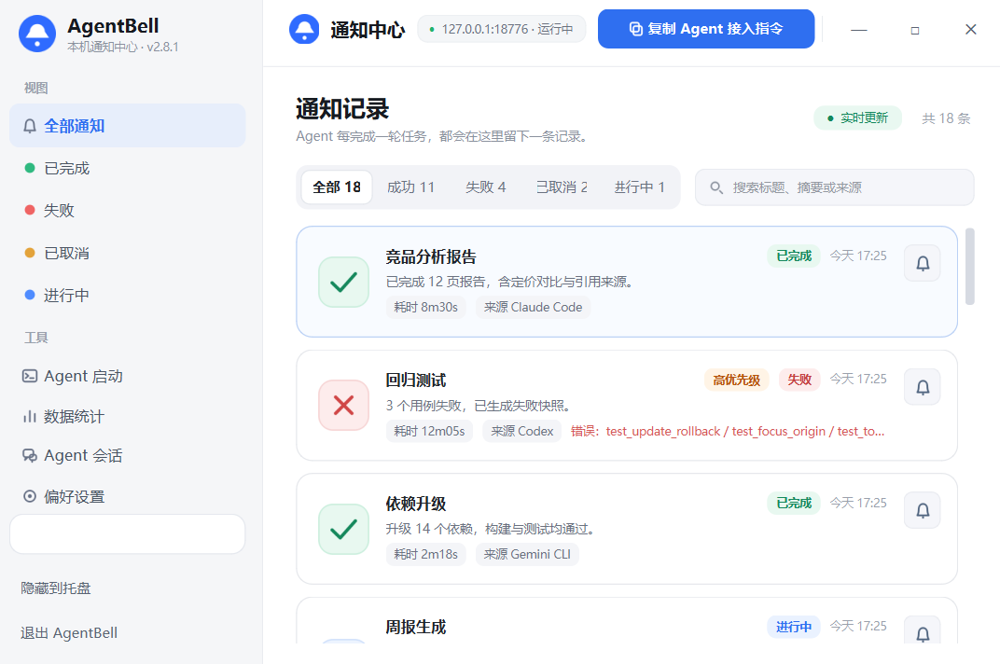
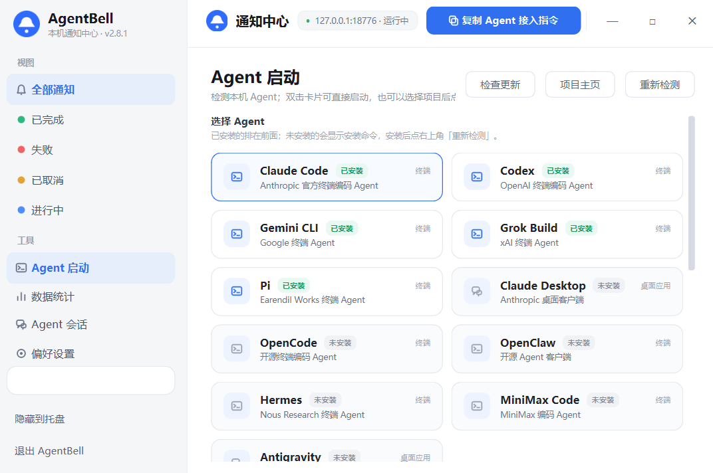
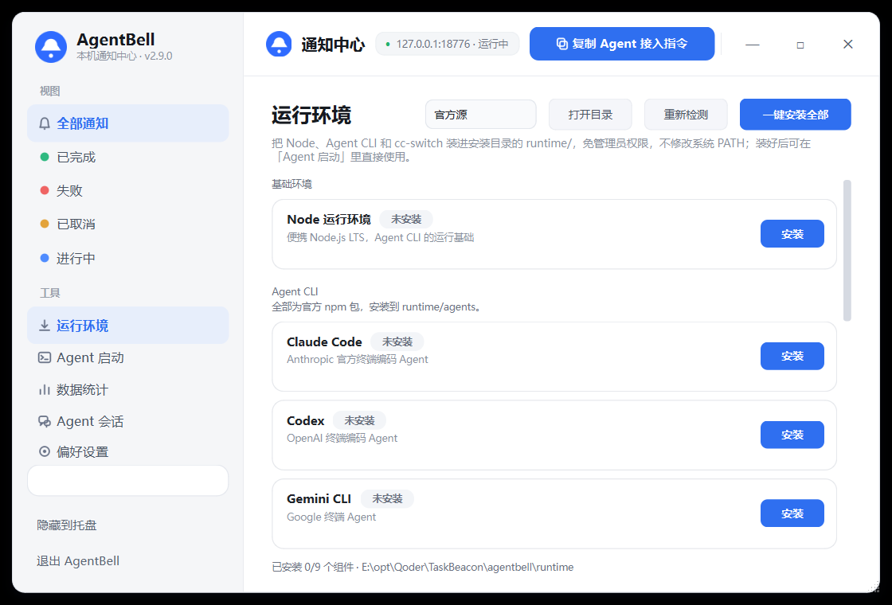
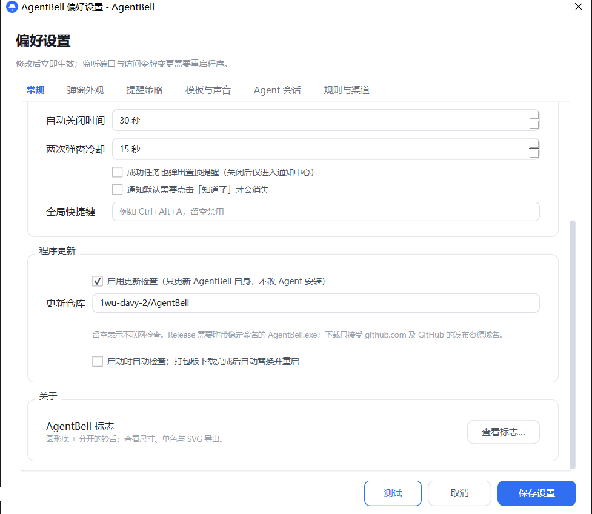

# AgentBell

<p align="center">
  <strong>Agent 每完成一轮，桌面就响一声。</strong><br>
  <sub>One ring per agent round, right on your desktop.</sub>
</p>

<p align="center">
  <a href="https://github.com/1wu-davy-2/AgentBell/releases/latest"></a>
  <a href="https://github.com/1wu-davy-2/AgentBell/actions/workflows/build.yml"></a>
  <a href="LICENSE"></a>
  
</p>

<p align="center">
  <a href="#中文">中文</a> ·
  <a href="README.en.md">English</a> ·
  <a href="https://github.com/1wu-davy-2/AgentBell/releases">Releases</a> ·
  <a href="system-architecture.md">系统架构</a>
</p>

---

## 中文

AgentBell 是一个只做提醒的 Windows 桌面工具。AI Agent 每轮任务结束时，向你本机的 HTTP 接口发一条消息，桌面右上角立刻弹出置顶提醒：

> 上一轮【生成竞品分析报告】已完成，请查看

它不接管 Agent、不代理模型请求、不上传数据，也没有网页控制台。HTTP 服务只监听 `127.0.0.1`，界面全部是 PySide6 原生窗口；关掉通知中心后，服务继续驻留托盘。

主要能力：

- 成功 / 失败 / 取消 / 进行中四种状态，支持进度、去重更新与优先级。
- 四套皮肤、三种弹窗模式，以及可拖拽定位的全屏遮挡。
- 免打扰、全屏 / 会议抑制、锁屏保留、聚合摘要与未读升级。
- 待确认、5/15/30 分钟稍后提醒，以及回到终端、打开链接、复制、重试等动作。
- 通知中心搜索、筛选、成功率 / 耗时统计与 7 天趋势。
- 内置 11 种 Agent 的检测与启动，默认使用安装目录下的 `chat/` 工作区。
- 便携运行环境：一键把 Node LTS、7 个官方 Agent CLI（Claude Code、Codex、Gemini CLI、OpenCode、OpenClaw、Hermes、Pi）和 cc-switch 装进安装目录的 `runtime/`，免管理员权限、不改系统 PATH；DeepSeek 作为供应商预设直接注入 Claude Code。
- 基于 GitHub Releases 的自身更新。

### 设计初衷

做 AgentBell 的起点很具体：用 Claude Code、Codex 这类 Agent 跑长任务时，最常做的动作是切回窗口看它有没有结束。系统通知太轻，错过就没有痕迹；完整的任务面板又太重，需要一直盯着。

所以它只把一件事做好：**在任务结束的那一刻提醒你，并让你能立刻回到现场。**

- **可离开**：Agent 在跑的时候可以去做别的事，结束了一声铃、一个卡片，不用守着窗口。
- **可闭环**：提醒不只是文字。带上 `origin.pid` 就能一键回到终端；失败可以重试，稍后可以再提醒。
- **少打扰**：免打扰时段、全屏与会议抑制、锁屏保留、短时间聚合、成功只进中心，都能按自己的习惯配置。
- **本机优先**：服务只绑定环回地址，历史保存在本机 SQLite，会话只读解析，不经过任何云端。
- **保持克制**：不编排 Agent、不修改你的工作流、不做 Web 面板；它只是安静地等在托盘里，在该响的时候响一声。

### 页面截图

> 截图使用独立调试端口 `18776`；正式运行的默认端口是 `127.0.0.1:8765`，可在偏好设置中修改。

**通知中心**：状态、来源、优先级、耗时一眼可见，支持搜索与筛选。



**数据统计**：成功率、平均耗时、待确认数量与近 7 天趋势。


**Agent 启动**：自动检测本机 Agent，双击已安装的卡片即可用当前项目启动。



**运行环境**：Node、Agent CLI 与 cc-switch 一键装进安装目录，卸载与重新检测都在这一页。



**偏好设置**：外观、打扰策略、程序更新、规则与外部渠道。



### 安装

**系统要求**：Windows 10/11。托盘、全局快捷键、全屏 / 会议检测、回到终端等完整功能目前仅 Windows 可用；macOS / Linux 可运行基础弹窗与通知中心。

#### 方式一：下载安装包（推荐）

1. 打开 [Releases](https://github.com/1wu-davy-2/AgentBell/releases/latest)，下载 `AgentBell.exe`。
2. 放到一个**可写目录**，例如 `D:\Tools\AgentBell`，双击运行。
3. 首次运行会在 exe 旁边生成 `config.json`、`logs/`、`agentbell.db` 和 `chat/`；在「运行环境」页安装组件时生成 `runtime/`。
4. 如果 Windows SmartScreen 提示“未知发布者”，点「更多信息 → 仍要运行」。程序没有代码签名，这是正常提示。
5. 关闭窗口只是隐藏到托盘；要彻底退出，用托盘菜单或左侧栏的「退出 AgentBell」。

Release 同时提供版本化文件名 `AgentBell-12.exe` 和 `SHA256SUMS.txt`。自动更新只使用稳定命名的 `AgentBell.exe`，请勿随意改名。

**开启自动更新**：打开「偏好设置 → 常规 → 程序更新」，填写 `1wu-davy-2/AgentBell`，勾选「启动时自动检查」。打包版会在下载完成、程序退出后自动备份、替换并重启；源码模式只下载安装包，不会替换正在运行的 Python 程序。

#### 方式二：从源码运行

需要 Python 3.10+。

```powershell
git clone git@github.com:1wu-davy-2/AgentBell.git
cd AgentBell
py -3 -m venv .venv
.venv\Scripts\Activate.ps1
pip install -r requirements.txt
python run.py
```

macOS / Linux：

```bash
git clone https://github.com/1wu-davy-2/AgentBell.git
cd AgentBell
python3 -m venv .venv
source .venv/bin/activate
pip install -r requirements.txt
python run.py
```

### 使用教程

#### 1. 发送第一条通知

在 `config.json` 里设置一个 `token`（留空则关闭鉴权），然后运行：

```powershell
$body = @{
  title    = "生成竞品分析报告"
  status   = "succeeded"
  summary  = "已完成 12 页报告"
  duration = "8m30s"
  source   = "Claude Code"
} | ConvertTo-Json

Invoke-RestMethod -Uri "http://127.0.0.1:8765/notify" -Method Post `
  -ContentType "application/json; charset=utf-8" `
  -Headers @{ "X-Token" = "your-token" } `
  -Body ([System.Text.Encoding]::UTF8.GetBytes($body))
```

成功调用返回 HTTP 202，桌面右上角出现通知卡片。中文必须按 UTF-8 发送；PowerShell 5.1 直接传字符串会把中文变成 `?`，上面的写法已转成 UTF-8 字节。curl、Python 和完整字段说明见 [system-architecture.md](system-architecture.md)。

#### 2. 使用通知中心

- 左侧按状态筛选，顶部搜索标题、摘要或来源；双击标题栏可最大化 / 还原。
- 关闭窗口后程序仍在托盘；按 `Ctrl+Alt+A` 或右键托盘图标可重新打开。
- 历史默认保留 1000 条，可在「数据统计」查看成功率、平均耗时和 7 天趋势。

#### 3. 让 Agent 每轮自动推送

1. 点击通知中心右上角的「复制 Agent 接入指令」。
2. 把剪贴板内容粘贴给 Agent（Claude Code、Codex、Qoder 等），发一次即可。
3. 指令包含当前端口、`X-Token`、字段说明和编码要求，并要求它**每轮任务结束都推送一次**，无论成功、失败还是取消。

如果希望通知卡片带「回到终端」按钮，让 Agent 在请求里带上 `origin.pid`；`window_title` 和 `working_dir` 可作为兜底。

#### 4. 一键装好 Agent 运行环境

打开「运行环境」页，点「一键安装全部」，或只安装需要的组件：

- **Node**：官方 LTS 便携包，解压到 `runtime/node`，用官方 `SHASUMS256.txt` 校验 SHA-256。
- **Agent CLI**：Claude Code、Codex、Gemini CLI、OpenCode、OpenClaw、Hermes、Pi 七个官方 npm 包，装到 `runtime/agents`，不写系统全局目录。
- **cc-switch**：GitHub Release 的便携版 zip，解压到 `runtime/cc-switch`。

全程不需要管理员权限，也不修改系统 `PATH`；AgentBell 只在检测和启动 Agent 时临时把这些目录加进子进程环境。装完到「Agent 启动」页点「重新检测」，新装的 CLI 会出现在已安装列表里。DeepSeek 没有官方 CLI，可在页面底部保存 API Key，用「用 DeepSeek 启动 Claude Code」以该供应商打开终端。

#### 5. 启动 Agent（可选）

打开「Agent 启动」页，AgentBell 会检测本机安装的 Claude Code、Claude Desktop、Codex、Gemini CLI、Grok Build、OpenCode、OpenClaw、Hermes、Pi、MiniMax Code、Antigravity。

- 首次启动会在安装目录自动创建 `chat/` 并默认选中；也可以浏览其他项目。
- 选择 Agent、项目目录并填写初始提示词后，点「打开终端并开始」；双击已安装的卡片也可以直接启动。
- 提示词通过环境变量传入，不拼接进 shell 命令。桌面应用只能打开窗口，无法预填提示词。
- 每张卡片右上角的「项目主页」可打开对应官网或 GitHub 仓库。

#### 6. 回到终端

通知请求带上来源进程信息：

```json
{
  "title": "生成竞品分析报告",
  "status": "succeeded",
  "origin": { "pid": 12345, "window_title": "Qoder", "working_dir": "E:\\proj\\report" }
}
```

通知卡片会出现「回到终端」按钮，点击后把宿主终端或编辑器窗口切到前台。它只做窗口级聚焦，不会选中具体标签页，也不执行命令；找不到窗口时会提示并把项目路径复制到剪贴板。

#### 7. 外观与打扰控制

在偏好设置里可以调整弹窗皮肤、弹窗模式、全屏背景与卡片位置，配置免打扰时段、全屏 / 会议抑制、锁屏保留、聚合摘要、待确认和稍后提醒。设置页底部的「测试」按钮会按当前配置弹出一条预览，不写入历史。

#### 8. 构建与发布

```powershell
pip install -r requirements-dev.txt
python -m PyInstaller --noconfirm --clean AgentBell12.spec
# 产物：dist\AgentBell-12.exe
```

推送到 `develop` 会触发测试与打包；推送 `v*` 标签会校验标签与 `agentbell/__init__.py` 的 `__version__` 一致，然后自动发布 Release。

```bash
git tag v2.9.0
git push origin develop --tags
```

### 授权

本项目采用 **MIT 许可证**，全文见 [LICENSE](LICENSE)。

你可以在保留版权与许可声明的前提下，自由使用、复制、修改、合并、发布、分发、再许可和销售本软件，包括用于商业项目。软件按“现状”提供，不附带任何明示或默示担保，使用风险由使用者自行承担。

MIT 只覆盖本仓库的源代码与文档。PySide6、FastAPI、uvicorn、Pydantic 等第三方依赖遵循各自许可证；AgentBell 的名称与标志仅用于标识本项目，MIT 不构成商标授权。

### 更多文档

- [README.en.md](README.en.md)：英文版说明文档。
- [system-architecture.md](system-architecture.md)：架构、完整配置、HTTP API、打包与安全说明。
- [config.example.json](config.example.json)：全部配置项示例。
- [.github/workflows/build.yml](.github/workflows/build.yml)：测试、打包与发布流程。
- [Releases](https://github.com/1wu-davy-2/AgentBell/releases)：安装包与校验和。
