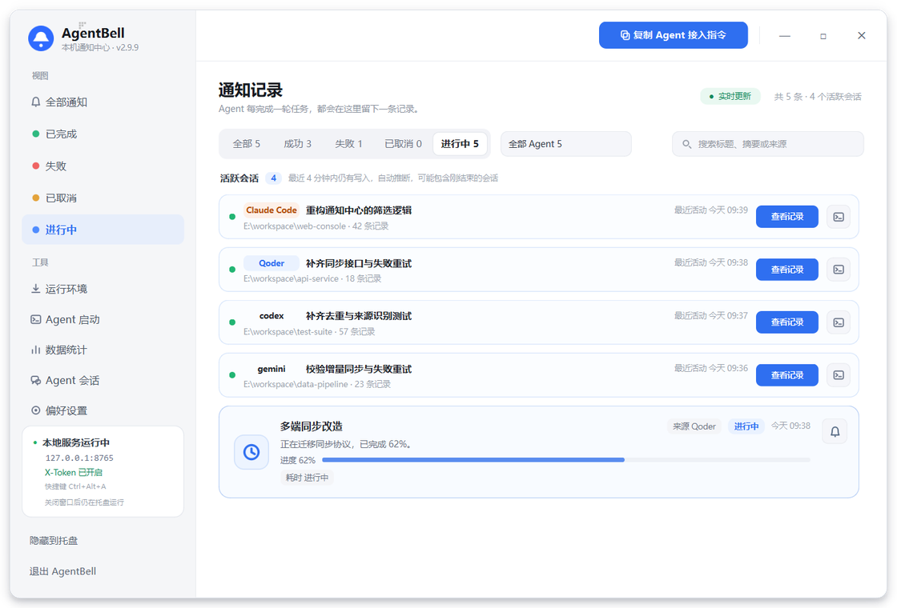
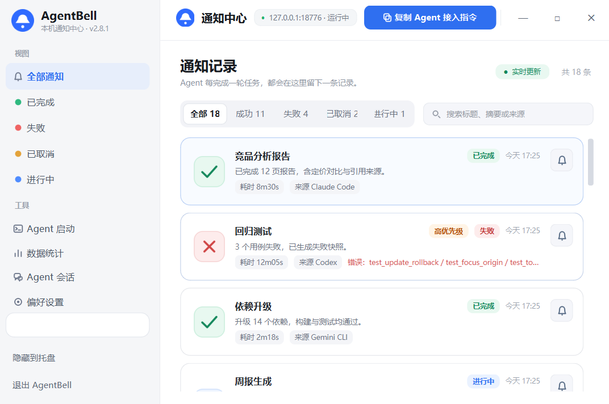
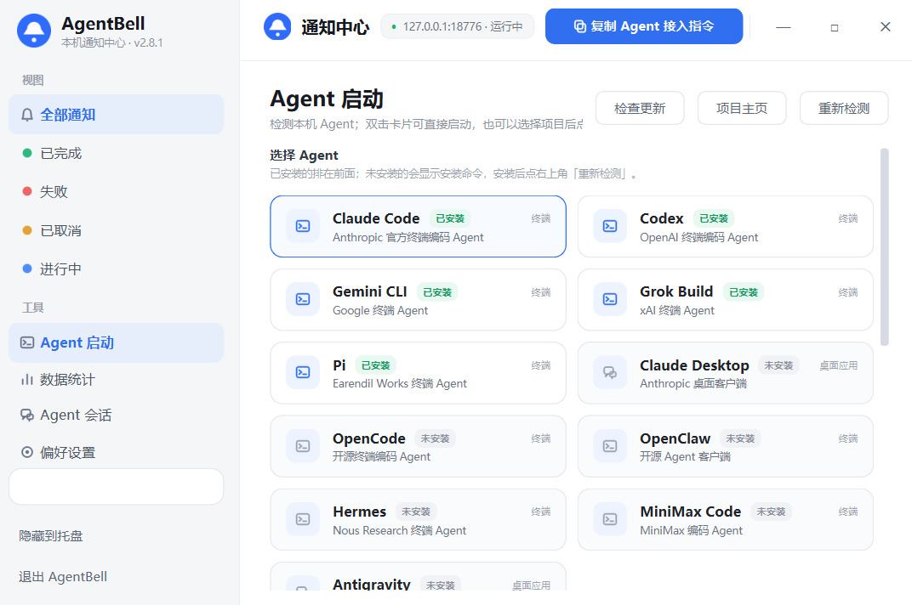
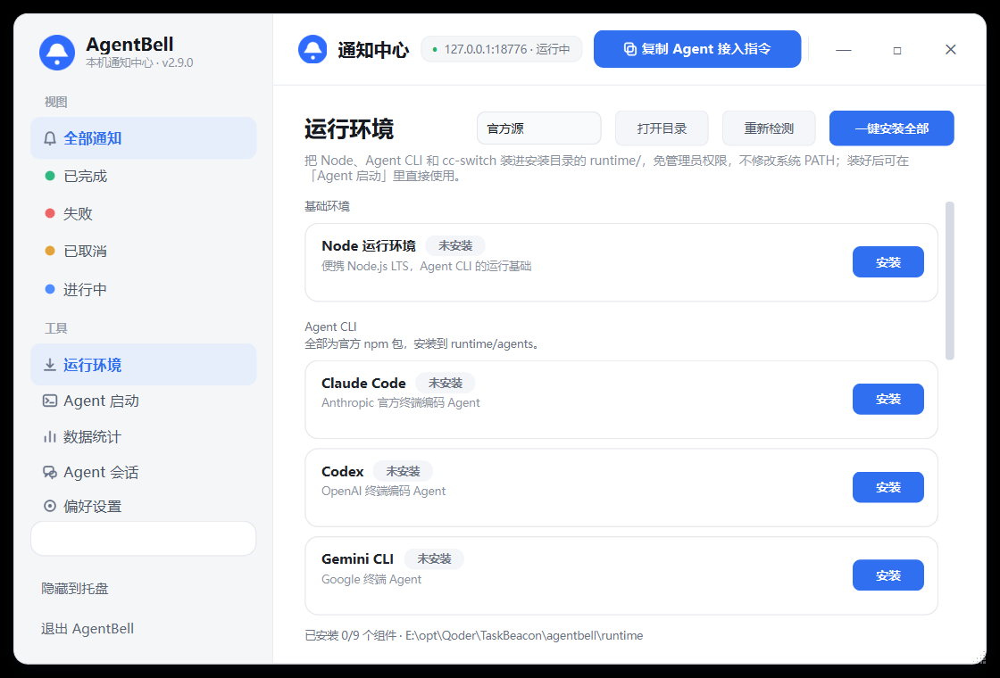
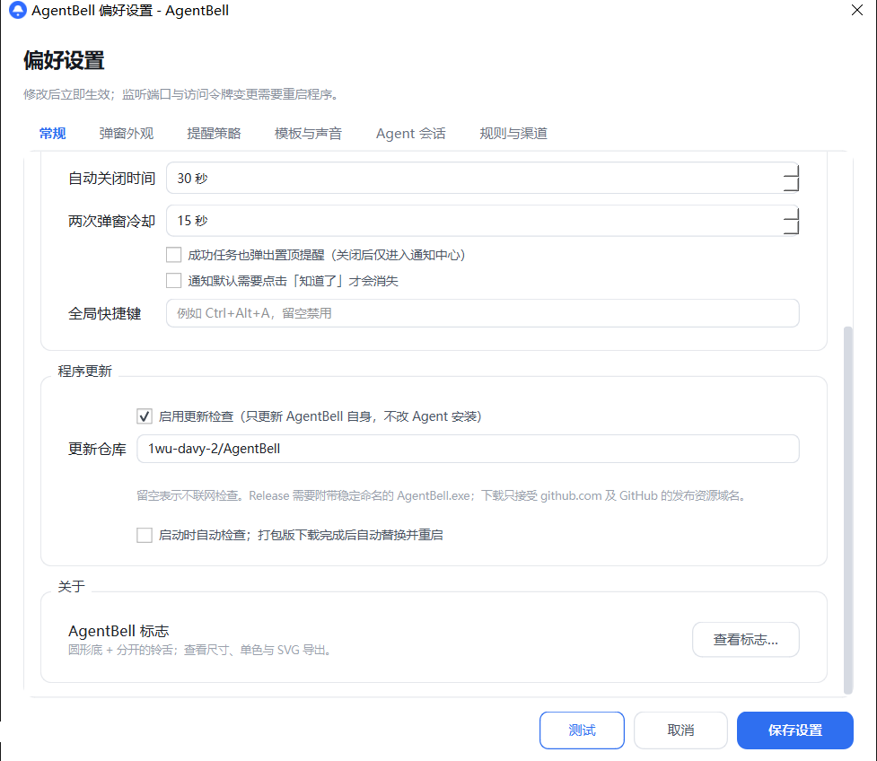

# AgentBell

<p align="center">
  <strong>Agent 每完成一轮，桌面就响一声。</strong><br>
  <sub>One ring per agent round, right on your desktop.</sub>
</p>

<p align="center">
  <a href="https://github.com/1wu-davy-2/AgentBell/releases/latest"></a>
  <a href="https://github.com/1wu-davy-2/AgentBell/actions/workflows/build.yml"></a>
  <a href="LICENSE"></a>
  
</p>

<p align="center">
  <a href="#中文">中文</a> ·
  <a href="README.en.md">English</a> ·
  <a href="https://1wu-davy-2.github.io/agentbell-site/">官网</a> ·
  <a href="https://github.com/1wu-davy-2/AgentBell/releases">Releases</a> ·
  <a href="system-architecture.md">系统架构</a>
</p>

---

## 中文

AgentBell 是一个只做提醒的 Windows / Linux 桌面工具。AI Agent 每轮任务结束时，向你本机的 HTTP 接口发一条消息，桌面右上角立刻弹出置顶提醒：

> 上一轮【生成竞品分析报告】已完成，请查看

它不接管 Agent、不代理模型请求、不上传数据，也没有网页控制台。HTTP 服务只监听 `127.0.0.1`，界面全部是 PySide6 原生窗口；关掉通知中心后，服务继续驻留托盘。

主要能力：

- 成功 / 失败 / 取消 / 进行中四种状态，支持进度、去重更新与优先级。
- 等待输入提醒：Agent 卡在权限确认、提问、限流或上下文超限时，卡片标出原因；支持显式上报与本地只读推断，并在「进行中」下提供「待输入」子筛选。
- 一键接入提醒：在「运行环境」页把 Claude Code、Gemini CLI、Grok 的等待与结束 Hook 写进各自用户配置；Codex 支持每轮结束提醒。写入前预览并备份，可随时撤销。
- 运行时间线：同一 `run_id` 的开始、等待、继续、完成会串成一条只追加的事件线；卡片可直接打开时间线弹窗，统计页按运行查看成功率、P50/P90 耗时与累计等待时长。
- 四套皮肤、三种弹窗模式，以及可拖拽定位、多显示器逐屏呈现的全屏遮挡；可让副屏只保留背景。
- 规则分流：可按等待原因、`needs_input`、运行时长和项目 glob 匹配，分别覆盖优先级、是否静音、确认、自动关闭、弹窗与额外通道；后匹配规则覆盖标量字段，设置保存后立即生效。
- 免打扰、全屏 / 会议抑制、锁屏保留、聚合摘要与未读升级。
- 待确认、5/15/30 分钟稍后提醒，以及回到终端、查看记录、打开时间线、打开链接、复制、重试等动作；查看记录与时间线只读，不包含审批或自动继续。
- 通知中心搜索、状态与 Agent 来源筛选、进行中自动汇入近期活跃的 Agent 会话，以及成功率 / 耗时统计与 7 天趋势。
- 内置 11 种 Agent 的检测与启动，默认使用安装目录下的 `chat/` 工作区。
- 便携运行环境：一键把 Node LTS 和 7 个官方 Agent CLI（Claude Code、Codex、Gemini CLI、OpenCode、OpenClaw、Hermes、Pi）装进安装目录的 `runtime/`，免管理员权限、不改系统 PATH；同时自动识别系统 Node 与 npm 全局安装的 CLI；cc-switch 等外部工具直接跳转官方下载页；DeepSeek 作为供应商预设直接注入 Claude Code。
- 基于 GitHub Releases 的自身更新。

### 最近更新

- **v2.16.1**：新增 Linux x64 / arm64 版本。Release 同时提供 `AgentBell-linux-x64.tar.gz` 和 `AgentBell-linux-arm64.tar.gz`，解压后直接运行 `AgentBell`；X11 桌面支持全局快捷键、回到终端、锁屏 / 空闲检测、终端启动和 Hook 接入，Wayland 下自动降级为基础提醒。Windows 行为保持不变。v2.16.0 标签因 Linux CI 测试未通过而没有发布，2.16.1 修复了跨平台路径解析与测试假设，功能与 2.16.0 相同。
- **v2.15.0**：全屏提醒支持「仅在主屏显示卡片」。多显示器仍逐屏铺满背景与遮罩，勾选后只有主屏绘制提醒卡片，副屏保留背景图；点击任意屏幕仍会关闭全部提醒。设置页「全屏显示区域」新增开关，配置项为 `overlay_area.card_on_primary_only`，默认关闭。
- **v2.14.0**：一键接入提醒。运行环境页新增「提醒接入」，可把 Claude Code（`~/.claude/settings.json`）、Gemini CLI（`~/.gemini/settings.json`）和 Grok（`~/.grok/hooks/agentbell.json`）的等待确认、提问与每轮结束 Hook 写入用户配置；Codex 通过顶层 `notify` 支持每轮结束提醒。写入前展示完整改动并备份，只追加带标记的条目，已有 Hook 保持不变，可随时撤销；已存在的 Codex 自定义 `notify` 不会被覆盖。
- **v2.13.0**：规则精细化。`rules` 新增 `wait_reason`、`needs_input`、`min_duration_seconds` / `max_duration_seconds` 与 `project` 条件，可把「等待权限」「测试项目」或「超过 10 分钟」的任务分流到不同优先级和通道；项目按工作目录名取末级、忽略大小写，时长从 `duration` 解析且边界包含，缺失时该条件不匹配。规则随设置保存立即生效，本地推断的等待通知同样参与匹配。通知中心的悬停提示同步收紧：仅在文字被截断时出现，限制为 32 字宽并统一浅色样式，不再用整卡大提示遮挡相邻记录。
- **v2.12.0**：新增只读动作。通知可声明 `session` / `timeline`，弹窗与通知中心会显示「查看记录」「时间线」按钮，直接打开本地会话或本次运行；两类动作只读取通知自身的 `session_id` / `run_id`，忽略 `value`，不执行外部命令。明确不提供批准权限、自动继续或发送提示词的动作。
- **v2.11.0**：新增运行时间线。同一 `run_id` 的开始、等待、继续、完成会写入只追加的 `run_events`，卡片「时间线」按钮可回看阶段与耗时；会话详情显示「本次运行」，统计页增加运行数、运行成功率、P50/P90 耗时与累计等待。支持 `/notify` 显式 `phase`，未传时按状态变化自动推断。
- **v2.10.0**：新增等待输入提醒。Agent 卡在权限确认、提问、限流或上下文超限时，通知卡片显示等待原因；「进行中」下可只看「待输入」会话。支持 `/notify` 显式上报，以及 Claude Code / Qoder 会话尾部的本地只读推断，推断结果带「推断」标记。
- **v2.9.10**：首次运行生成的 `config.json` 默认填入 `1wu-davy-2/AgentBell` 并保持启动检查，下载后约 9 秒即可检查新版本。
- **v2.9.9**：「进行中」自动汇集近期活跃的 Agent 会话，只读展示 Agent、项目、最近活动与记录数，并随来源筛选与搜索收窄。
- **v2.9.8**：Agent 来源筛选与状态、搜索叠加；程序更新支持在启动约 9 秒后自动检查新版本。
- **v2.9.7**：「回到终端」在 Windows 前台锁拒绝普通置前时，继续尝试附加输入队列与 `SwitchToThisWindow`，确保键盘焦点真正落下。
- **v2.9.5–2.9.6**：修复切换状态筛选约 10 秒假死；通知缺少 `origin` / `source` 时，按本机连接反查发送进程并补出来源。

### 设计初衷

做 AgentBell 的起点很具体：用 Claude Code、Codex 这类 Agent 跑长任务时，最常做的动作是切回窗口看它有没有结束。系统通知太轻，错过就没有痕迹；完整的任务面板又太重，需要一直盯着。

所以它只把一件事做好：**在任务结束的那一刻提醒你，并让你能立刻回到现场。**

- **可离开**：Agent 在跑的时候可以去做别的事，结束了一声铃、一个卡片，不用守着窗口。
- **可闭环**：提醒不只是文字。带上 `origin.pid` 就能一键回到终端；失败可以重试，稍后可以再提醒。
- **少打扰**：免打扰时段、全屏与会议抑制、锁屏保留、短时间聚合、成功只进中心，都能按自己的习惯配置。
- **本机优先**：服务只绑定环回地址，历史保存在本机 SQLite，会话只读解析，不经过任何云端。
- **保持克制**：不编排 Agent、不修改你的工作流、不做 Web 面板；它只是安静地等在托盘里，在该响的时候响一声。

### 页面截图

> 截图使用演示数据；默认端口是 `127.0.0.1:8765`，可在偏好设置中修改。

**通知中心**：状态、Agent 来源与搜索叠加筛选；「进行中」自动汇入活跃会话，任务结束可直接回到终端。



**数据统计**：成功率、平均耗时、待确认数量与近 7 天趋势。



**Agent 启动**：自动检测本机 Agent，双击已安装的卡片即可用当前项目启动。



**运行环境**：Node 与 Agent CLI 一键装进安装目录，也可识别系统 Node 与 npm 全局 CLI；cc-switch 等外部工具跳转下载页。



**偏好设置**：外观、打扰策略、程序更新、规则与外部渠道。



### 安装

**系统要求**：Windows 10/11，或带 X11 的 Linux 桌面（x64 / arm64）。Windows 提供完整功能；Linux X11 支持托盘、全局快捷键、全屏 / 会议检测、回到终端与终端启动；Wayland 会停用全局快捷键、窗口聚焦与前台检测，仅保留弹窗、通知中心、Hook、运行环境和托盘。

#### 方式一：下载安装包（推荐）

**Windows**

1. 打开 [Releases](https://github.com/1wu-davy-2/AgentBell/releases/latest)，下载 `AgentBell.exe`。
2. 放到一个**可写目录**，例如 `D:\Tools\AgentBell`，双击运行。
3. 首次运行会在 exe 旁边生成 `config.json`、`logs/`、`agentbell.db` 和 `chat/`；在「运行环境」页安装组件时生成 `runtime/`。
4. 如果 Windows SmartScreen 提示“未知发布者”，点「更多信息 → 仍要运行」。程序没有代码签名，这是正常提示。
5. 关闭窗口只是隐藏到托盘；要彻底退出，用托盘菜单或左侧栏的「退出 AgentBell」。

Release 提供稳定命名的 `AgentBell.exe` 和 `SHA256SUMS.txt`；自动更新只使用 `AgentBell.exe`，请勿改名。带构建编号的 `AgentBell-*.exe` 是同一文件的版本化副本，下载时选 `AgentBell.exe` 即可。

**Linux（x64 / arm64）**

1. 按架构下载 `AgentBell-linux-x64.tar.gz` 或 `AgentBell-linux-arm64.tar.gz`。
2. 解压到可写目录并运行：

```bash
mkdir -p ~/AgentBell
tar -xzf AgentBell-linux-x64.tar.gz -C ~/AgentBell
chmod +x ~/AgentBell/AgentBell
~/AgentBell/AgentBell
```

3. 首次运行会在程序旁生成 `config.json`、`logs/`、`agentbell.db` 和 `chat/`。设置页的「登录桌面后自动启动」会写入 `~/.config/autostart/agentbell.desktop`。
4. 自动更新只使用当前架构对应的 `AgentBell-linux-<arch>.tar.gz`，下载后会校验大小与 SHA-256，再替换并重启。

Linux 需要系统具备 `libegl1`、`libgl1`、`libxkbcommon-x11-0`、`libxcb-*` 等 Qt 运行库；Debian / Ubuntu 可安装 `libegl1 libgl1 libxkbcommon-x11-0 libxcb-cursor0 libxcb-icccm4 libxcb-image0 libxcb-keysyms1 libxcb-randr0 libxcb-render-util0 libxcb-shape0 libxcb-xinerama0 libxcb-xfixes0`。

**开启自动更新**：首次运行生成的 `config.json` 默认填入 `1wu-davy-2/AgentBell` 并勾选「启动时自动检查」，启动约 9 秒后检查 Releases，也可从托盘或 Agent 启动页手动检查。打包版会在下载完成、程序退出后自动备份、替换并重启；源码模式只下载安装包，不会替换正在运行的 Python 程序。从旧版本升级且仓库为空时，在「偏好设置 → 常规 → 程序更新」填写即可。

#### 方式二：从源码运行

需要 Python 3.10+。

```powershell
git clone git@github.com:1wu-davy-2/AgentBell.git
cd AgentBell
py -3 -m venv .venv
.venv\Scripts\Activate.ps1
pip install -r requirements.txt
python run.py
```

macOS / Linux：

```bash
git clone https://github.com/1wu-davy-2/AgentBell.git
cd AgentBell
python3 -m venv .venv
source .venv/bin/activate
pip install -r requirements.txt
python run.py
```

### 使用教程

#### 1. 发送第一条通知

在 `config.json` 里设置一个 `token`（留空则关闭鉴权），然后运行：

```powershell
$body = @{
  title    = "生成竞品分析报告"
  status   = "succeeded"
  summary  = "已完成 12 页报告"
  duration = "8m30s"
  source   = "Claude Code"
} | ConvertTo-Json

Invoke-RestMethod -Uri "http://127.0.0.1:8765/notify" -Method Post `
  -ContentType "application/json; charset=utf-8" `
  -Headers @{ "X-Token" = "your-token" } `
  -Body ([System.Text.Encoding]::UTF8.GetBytes($body))
```

成功调用返回 HTTP 202，桌面右上角出现通知卡片。中文必须按 UTF-8 发送；PowerShell 5.1 直接传字符串会把中文变成 `?`，上面的写法已转成 UTF-8 字节。curl、Python 和完整字段说明见 [system-architecture.md](system-architecture.md)。

#### 2. 使用通知中心

- 左侧按状态筛选，顶部「全部 Agent」下拉按来源筛选，搜索可叠加；「进行中」会自动汇入近期活跃的 Agent 会话，点「查看记录」只读查看。双击标题栏可最大化 / 还原。
- 关闭窗口后程序仍在托盘；按 `Ctrl+Alt+A` 或右键托盘图标可重新打开。
- 历史默认保留 1000 条，可在「数据统计」查看成功率、平均耗时、7 天趋势，以及运行数、运行成功率、P50/P90 耗时与累计等待。

#### 3. 让 Agent 每轮自动推送

1. 点击通知中心右上角的「复制 Agent 接入指令」。
2. 把剪贴板内容粘贴给 Agent（Claude Code、Codex、Qoder 等），发一次即可。
3. 指令包含当前端口、`X-Token`、字段说明和编码要求，并要求它**每轮任务结束都推送一次**，无论成功、失败还是取消。

如果希望通知卡片带「回到终端」按钮，让 Agent 在请求里带上 `origin.pid`；`window_title` 和 `working_dir` 可作为兜底。即使忘了填，AgentBell 也会尝试按本机连接自动识别发送进程；`source` 留空时同样会自动补出来源 Agent。需要「查看记录」或「时间线」按钮时，按第 6 节在 `actions` 中声明只读动作。

#### 4. 一键接入提醒（可选）

除让 Agent 主动推送外，也可以在「运行环境 → 提醒接入」直接写入 Agent 自己的 Hook：

- **Claude Code**：用户级 `~/.claude/settings.json`，接入 `UserPromptSubmit`、`Notification`、`Stop`。
- **Gemini CLI**：用户级 `~/.gemini/settings.json`，接入 `BeforeAgent`、`Notification`、`AfterAgent`。
- **Grok**：用户级 `~/.grok/hooks/agentbell.json`，接入 `UserPromptSubmit`、`Notification`、`Stop`、`StopFailure`、`StopCancelled`。
- **Codex**：只支持顶层 `notify`，因此仅能感知每轮结束，无法感知等待确认；已有自定义 `notify` 时不会覆盖。

接入前会展示将写入的事件和完整配置，确认后先按时间戳备份，再只追加带 `agentbell-hook` 标记的条目；已有 Hook、MCP 和密钥保持不变。点「撤销」只会移除 AgentBell 自己的条目。等待与结束通知都带来源、工作目录、会话 ID 和只读的「查看记录 / 时间线」动作；Hook 只调用本机 AgentBell，不会批准权限、自动继续或发送提示词。Codex 的等待确认仍需回到终端处理。写入后重启对应 Agent 或新开会话生效；JSON 配置会按 2 空格缩进重写，原有缩进与空行可能变化。备份是原文件的完整拷贝，可能包含密钥，请按敏感文件处理。

#### 5. 提醒等待输入（可选）

Agent 停下来等你处理时，可以让它显式上报一条 `status="running"` 的通知，并带上 `needs_input`：

```json
{
  "title": "Claude Code 等待权限确认",
  "status": "running",
  "needs_input": true,
  "wait_reason": "permission",
  "wait_source": "explicit",
  "session_id": "abc123",
  "summary": "需要允许执行 npm test",
  "source": "Claude Code"
}
```

`wait_reason` 可选 `permission` / `question` / `rate_limit` / `context_limit` / `other`，缺省为 `other`；`needs_input=true` 只能与 `running` 一起使用。卡片会显示等待原因，通知中心「进行中」页会出现「待输入」子筛选；同一会话的后续事件，或显式上报 `needs_input=false`，会结束这次等待。

没有显式上报时，AgentBell 也可以在「偏好设置 → Agent」中开启本地推断：只读取最近 10 分钟内 Claude Code / Qoder 会话文件的尾部，连续两次扫描命中且闲置达到阈值才提醒，结果标记为「推断」。推断不写入会话文件，也不会把会话正文写进日志；关闭推断后只保留显式上报。Claude Code Hook、通用脚本与 Python 片段见 [docs/waiting-input.md](docs/waiting-input.md)。

#### 6. 查看运行时间线（可选）

同一个 `run_id` 的事件会聚成一次运行。AgentBell 按以下顺序确定运行编号：请求里的 `run_id` → `session:<session_id>` → `notify:<dedupe_key>` → `single:<通知 id>`。未传 `phase` 时，首次 `running` 记为「开始」，终态记为「完成」，并自动补出「等待输入 / 已继续」：

```json
{
  "title": "生成竞品分析报告",
  "status": "running",
  "session_id": "abc123",
  "summary": "正在生成第 3 页",
  "phase": "progress"
}
```

`phase` 可选 `started` / `progress` / `waiting_input` / `resumed` / `finished` / `note`；显式传入时按原样追加一条事件，不再自动推断。同一运行、同一阶段 5 秒内重复上报会合并为一条，避免进度刷屏。通知卡片右侧出现「时间线」按钮后，可查看阶段、相对耗时、状态和来源；会话详情页会显示最近一次运行的摘要，统计页可看运行级指标。完整字段见 [system-architecture.md](system-architecture.md)。

如果希望弹窗和通知中心直接出现「查看记录」「时间线」按钮，让 Agent 在 `actions` 里声明只读动作：

```json
{
  "title": "等待权限确认",
  "status": "running",
  "session_id": "abc123",
  "run_id": "run-001",
  "actions": [
    {"kind": "session", "label": "查看记录"},
    {"kind": "timeline", "label": "时间线"}
  ]
}
```

`session` 需要 `session_id`，`timeline` 需要 `run_id`（或可回落到 `session_id` / `dedupe_key`）；两类动作都不读取 `value`，只打开 AgentBell 内的只读记录。找不到会话或运行时会给出非阻塞提示，不执行任何外部命令。AgentBell 不提供“批准权限”“自动继续”或“发送提示词”动作，审批请回到终端完成。

#### 7. 一键装好 Agent 运行环境

打开「运行环境」页，点「一键安装全部」即装好 Node 与 7 个 CLI，也可只安装需要的组件：

- **Node**：官方 LTS 便携包，解压到 `runtime/node`，用官方 `SHASUMS256.txt` 校验 SHA-256。
- **Agent CLI**：Claude Code、Codex、Gemini CLI、OpenCode、OpenClaw、Hermes、Pi 七个官方 npm 包，装到 `runtime/agents`，不写系统全局目录。
- **cc-switch 等外部工具**：不在 AgentBell 内代装，点该行的「打开下载页」跳到 GitHub Releases 自行下载解压。

页面也会自动识别系统安装：PATH 中的 Node 及其 npm 全局 CLI 会标记为「系统 v…」，不会显示卸载；需要统一管理时，可点「安装便携版」在 `runtime/` 再装一份。

全程不需要管理员权限，也不修改系统 `PATH`；AgentBell 只在检测和启动 Agent 时临时把这些目录加进子进程环境。装完到「Agent 启动」页点「重新检测」，新装的 CLI 会出现在已安装列表里。DeepSeek 没有官方 CLI，可在页面底部保存 API Key，用「用 DeepSeek 启动 Claude Code」以该供应商打开终端。

#### 8. 启动 Agent（可选）

打开「Agent 启动」页，AgentBell 会检测本机安装的 Claude Code、Claude Desktop、Codex、Gemini CLI、Grok Build、OpenCode、OpenClaw、Hermes、Pi、MiniMax Code、Antigravity。

- 首次启动会在安装目录自动创建 `chat/` 并默认选中；也可以浏览其他项目。
- 选择 Agent、项目目录并填写初始提示词后，点「打开终端并开始」；双击已安装的卡片也可以直接启动。
- 提示词通过环境变量传入，不拼接进 shell 命令。桌面应用只能打开窗口，无法预填提示词。
- 每张卡片右上角的「项目主页」可打开对应官网或 GitHub 仓库。

#### 9. 回到终端

通知请求带上来源进程信息：

```json
{
  "title": "生成竞品分析报告",
  "status": "succeeded",
  "source": "Qoder",
  "origin": { "pid": 12345, "window_title": "Qoder", "working_dir": "E:\\proj\\report" }
}
```

通知卡片会出现「回到终端」按钮，点击后把宿主终端或编辑器窗口切到前台。它只做窗口级聚焦，不会选中具体标签页，也不执行命令；找不到窗口时会提示并把项目路径复制到剪贴板。

`source` 会显示在弹窗和通知中心。请求没带 `origin` 或 `source` 时，AgentBell 会用发起请求的本机端口找到发送进程，尽力补出「回到终端」和来源 Agent；显式填写仍然最准确。

#### 10. 外观与打扰控制

在偏好设置里可以调整弹窗皮肤、弹窗模式、全屏背景与卡片位置，配置免打扰时段、全屏 / 会议抑制、锁屏保留、聚合摘要、待确认和稍后提醒。设置页底部的「测试」按钮会按当前配置弹出一条预览，不写入历史。

#### 11. 构建与发布

```powershell
pip install -r requirements-dev.txt
python -m PyInstaller --noconfirm --clean AgentBell29.spec
# 产物：dist\AgentBell-29.exe
```

Linux 原生构建（不跨架构编译）：

```bash
pip install -r requirements-dev.txt
python -m PyInstaller --noconfirm AgentBell-linux.spec
tar -czf dist/AgentBell-linux-x64.tar.gz -C dist AgentBell
```

推送到 `develop` 会触发 Windows 与 Linux（x64 / arm64）测试和打包；推送 `v*` 标签会校验标签与 `agentbell/__init__.py` 的 `__version__` 一致，然后自动发布 Release。工作流会选用编号最大的 `AgentBell<N>.spec` 并把产物复制为稳定命名的 `AgentBell.exe`；Linux 则按架构生成 `AgentBell-linux-x64.tar.gz` 与 `AgentBell-linux-arm64.tar.gz`，最后合并一份 `SHA256SUMS.txt`。

```bash
git tag v2.16.1
git push origin develop --tags
```

### 授权

本项目采用 **MIT 许可证**，全文见 [LICENSE](LICENSE)。

你可以在保留版权与许可声明的前提下，自由使用、复制、修改、合并、发布、分发、再许可和销售本软件，包括用于商业项目。软件按“现状”提供，不附带任何明示或默示担保，使用风险由使用者自行承担。

MIT 只覆盖本仓库的源代码与文档。PySide6、FastAPI、uvicorn、Pydantic 等第三方依赖遵循各自许可证；AgentBell 的名称与标志仅用于标识本项目，MIT 不构成商标授权。

### 更多文档

- [README.en.md](README.en.md)：英文版说明文档。
- [system-architecture.md](system-architecture.md)：架构、完整配置、HTTP API、打包与安全说明。
- [config.example.json](config.example.json)：全部配置项示例。
- [.github/workflows/build.yml](.github/workflows/build.yml)：测试、打包与发布流程。
- [Releases](https://github.com/1wu-davy-2/AgentBell/releases)：安装包与校验和。
